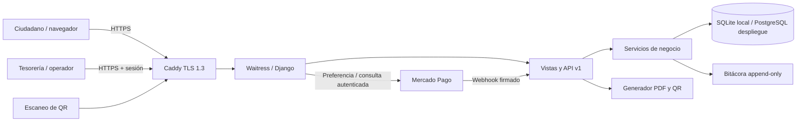
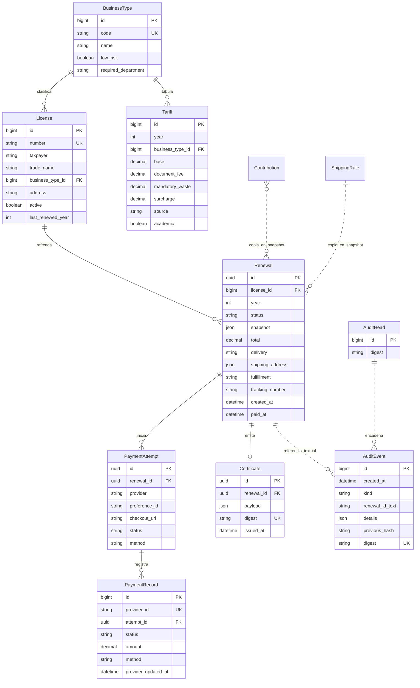
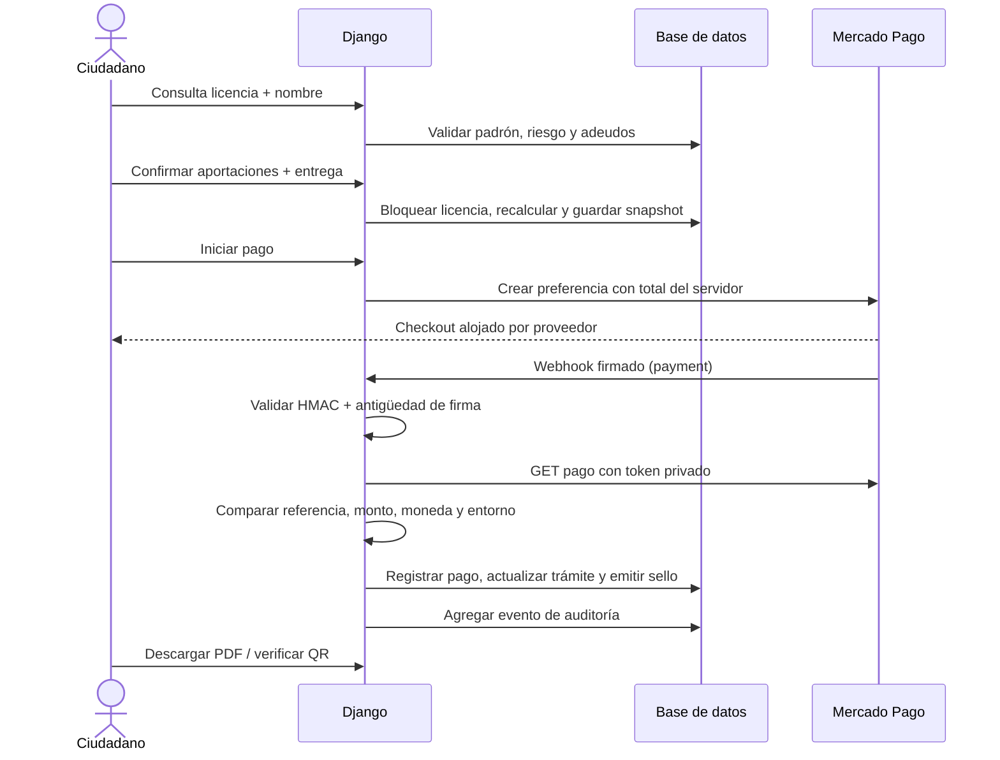

# Arquitectura y modelo de datos

## 1. Contexto y alcance

Cliente simulado: Ayuntamiento de Tonalá, Jalisco. Plataforma académica de refrendo para giros de bajo riesgo, ejercicio parametrizable (2026 por defecto). No sustituye una licencia ni un recibo oficial.

Se adopta un **monolito modular Django**: reduce el tiempo de desarrollo y permite mantener liquidación, pago, emisión y auditoría en una transacción de base de datos. HTML renderizado en servidor y JavaScript progresivo para cotizar y actualizar el estado. No necesita una aplicación SPA ni un servidor Node en operación.

## 2. Componentes

En modo demo, un adaptador interno sustituye la pasarela y aplica el mismo servicio transaccional de pagos. El formulario no simula ser la página de Mercado Pago ni solicita información de tarjeta.

## 3. Estructura de código

| Componente | Responsabilidad |
|---|---|
| `config/settings.py` | Entorno, sesiones, seguridad, PostgreSQL/SQLite y variables del proveedor |
| `refrendo/models.py` | Padrón simulado, catálogos, trámites, pagos, carátulas y bitácora |
| `refrendo/forms.py` | Validación de consulta, entrega, aportaciones y resultados de demostración |
| `refrendo/services.py` | Elegibilidad, cotización, congelación, pagos y auditoría |
| `refrendo/payments.py` | API Mercado Pago, preferencias, firmas y conciliación |
| `refrendo/documents.py` | Carátula, QR y URL de verificación |
| `refrendo/views.py` | Autorización por sesión, endpoints y panel de operación |
| `refrendo/admin.py` | Catálogos editables y registros financieros de solo consulta |
| `refrendo/migrations/0002_append_only.py` | Prohibición de cambios/borrados en bitácora y certificados |
| `templates/`, `static/portal/` | Interfaz responsive sin recursos remotos obligatorios |

## 4. Modelo entidad-relación (DER)

Las relaciones punteadas indican datos copiados o referencias lógicas, no claves foráneas. El evento conserva sus datos aunque cambie un catálogo. `Contribution` contiene nombre, importe y disponibilidad; `ShippingRate` contiene prefijo postal único, zona, importe y disponibilidad. `LookupThrottle` guarda hash de IP, ventana de cinco minutos y contador; no almacena la IP en claro.

Restricciones: licencia única por número; tabulador único por giro/año; un trámite por licencia/año; ID de pago único global; una carátula por trámite; sello único. Los importes usan Decimal y dos decimales. FK financieras usan PROTECT para evitar borrados de registros referenciados. El folio corto mostrado es una referencia legible; el identificador autoritativo del trámite es su UUID completo.

## 5. Flujo transaccional

La URL de regreso no modifica el pago. Los duplicados son idempotentes; notificaciones anteriores a `provider_updated_at` se ignoran. Para varios pagos de una preferencia se conservan registros independientes. Un pago reembolsado o con contracargo invalida el documento si no queda otro pago aprobado. Más de un pago aprobado produce un evento de revisión para Tesorería; no se ordenan reembolsos automáticamente.

La preferencia se reutiliza para evitar generar múltiples checkouts por doble clic. Si el proveedor deja una preferencia no reutilizable, Tesorería debe reconciliar antes de habilitar un nuevo intento; no se recrea a ciegas una preferencia con deuda potencialmente pagada.

## 6. Seguridad y privacidad

- CSRF en formularios y API por sesión; solo el webhook firmado está exento.
- Sesión de una hora para consultar trámites del ciudadano; UUID por sí solo no autoriza el acceso.
- La consulta se basa en los dos datos exigidos por RF-01. Esto es una verificación débil por diseño del enunciado, no autenticación fuerte. Se limita a 20 intentos por IP y cinco minutos. No se confía en X-Forwarded-For arbitrario.
- Permisos separados: `view_renewal`, `change_renewal`, `view_auditevent`. Login y contraseñas gestionados por Django.
- CSP, DENY para frames, política de referente, cookies HttpOnly/SameSite y, en despliegue, Secure/HSTS.
- QR con **HMAC-SHA256**, no un SHA-256 sin secreto. El documento contiene los datos firmados y el servidor compara en tiempo constante. HMAC es autenticación simétrica; no es una firma electrónica avanzada ni acredita autoría legal municipal.
- Certificados y eventos: inserción permitida, UPDATE/DELETE bloqueados por triggers en SQLite/PostgreSQL. Una cadena HMAC permite detectar modificaciones e inconsistencias en su cabecera.
- Un administrador de base de datos puede desactivar triggers o restaurar una copia antigua. Para inmutabilidad frente a administradores se requieren permisos separados, exportación de sellos y almacenamiento WORM externo. No se promete esa garantía con una sola base local.
- La verificación pública omite razón social, dirección y teléfono de envío. Se exponen únicamente folio, número, nombre comercial, año y vigencia.
- Exportación CSV neutraliza celdas que podrían interpretarse como fórmulas.

## 7. Disponibilidad

Objetivo RNF-02: 99.5% mensual (aproximadamente 3 h 36 min de indisponibilidad en 30 días). No es una medición lograda.

El paquete usa archivos estáticos locales y una aplicación sin archivos de sesión locales; las sesiones viven en base de datos y permiten múltiples instancias con claves compartidas. Escalado objetivo: balanceador, dos o más instancias web, PostgreSQL administrado con alta disponibilidad, backups diarios, retención y prueba de restauración, monitoreo de `/salud/`, alerta ante fallos y conciliación de notificaciones perdidas. El Compose incluido es una instalación de pruebas de un solo host y no elimina ese punto único de falla.

A mayor carga, mover throttling a un almacén compartido con TTL; revisar retención de contadores y logs, bloqueos de auditoría, índices y tiempo de consulta al proveedor. SQLite es apropiado para la presentación local; PostgreSQL es el destino para concurrencia. No se realizaron pruebas de carga ni de SLA.
