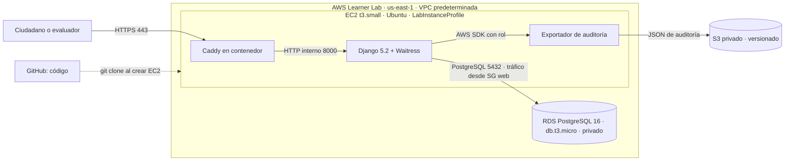

# AWS y despliegue - Refrendo Tonalá

**Fecha de corte de la documentación:** 24 de noviembre de 2026  
**Región definida por el script:** `us-east-1`  
**Tipo de entorno:** demostración académica en AWS Academy Learner Lab

## Alcance y estado de la evidencia

El script Bash utiliza AWS CLI y User Data para aprovisionar los recursos. El 23 de noviembre se repitieron las pruebas locales de Django y se simularon tres fallas controladas. El 24 de noviembre se observó el portal por HTTPS, su interrupción al detener Django y la recuperación de la pantalla principal tras el arranque manual. El reinicio automático y las pruebas de recuperación de los servicios administrados siguen pendientes. [Resultados de resiliencia](RESILIENCIA.md).

| Elemento | Implementación en archivos | Evidencia disponible |
|---|---|---|
| Aplicación web | Django 5.2, Waitress, Docker Compose | `VERIFICACION-FINAL.txt` y suite local registrada: recorrido en navegador y 44 pruebas aprobadas |
| Aprovisionamiento | `infra/deploy_aws.sh`, AWS CLI y User Data | Código revisado; el hilo anterior confirma una ejecución donde RDS quedó disponible y EC2 en ejecución |
| Base de datos | Amazon RDS PostgreSQL 16, `db.t3.micro`, no pública | Estado anterior reportado: PostgreSQL 16.15 `available`; no hay salida CLI adjunta al ZIP |
| Servidor | Amazon EC2 `t3.small`, Ubuntu 22.04, perfil `LabInstanceProfile` | Detención y arranque manual del contenedor web confirmados mediante capturas |
| Archivos de auditoría | Bucket S3 privado, versionado y bloqueo de acceso público | La configuración está en el script; no hay recibo ni listado de objetos del bucket en la evidencia recibida |
| URL HTTPS | Caddy y `<IP>.sslip.io`, renovada al arranque | HTTP 200 en `/salud/` antes de la prueba, 502 durante la falla y 200 tras el arranque manual |

## Arquitectura



El navegador llega a Caddy por los puertos 80/443. Caddy envía solicitudes al contenedor Django por el puerto interno 8000. Django guarda trámites, pagos, certificados y auditoría en RDS. El exportador verifica la cadena HMAC y guarda un sello JSON en S3. El script configura RDS sin acceso público y permite el puerto 5432 solo desde el grupo web. La configuración abre 22/80/443 desde Internet en el grupo web; el acceso SSH abierto es una limitación de seguridad identificada.

## Requisitos previos

- Cuenta y sesión activa de AWS Academy Learner Lab con permisos de creación para EC2, RDS, S3, EC2 key pairs, Security Groups, SSM Parameter Store y uso del perfil `LabInstanceProfile`.
- AWS CLI, Git, Bash, `openssl`, `curl` y `chmod` en CloudShell.
- Repositorio Git accesible públicamente para que la instancia EC2 pueda clonar el código durante User Data. Si es privado, el script actual no configura credenciales de clonación.
- Región `us-east-1` y VPC predeterminada disponible.
- Saldo del laboratorio suficiente. Los permisos del Learner Lab pueden cambiar y causar errores de aprovisionamiento.

## Despliegue desde cero

El instalador original se conserva como evidencia de la infraestructura por código. Úsalo con una cuenta de laboratorio sin recursos del proyecto. El script reemplaza el par `refrendo-tonala-key` y no está preparado para repetir el aprovisionamiento sobre recursos existentes. Comprueba primero tu identidad, si ya hay EC2 del proyecto y el parche que admite RDS:

```bash
aws sts get-caller-identity
aws ec2 describe-instances --region us-east-1 \
  --filters 'Name=tag:Name,Values=refrendo-tonala-web' \
  --query 'Reservations[].Instances[].[InstanceId,State.Name]' --output table
aws rds describe-db-engine-versions --region us-east-1 --engine postgres \
  --query 'DBEngineVersions[?starts_with(EngineVersion, `16.`)].EngineVersion' --output table
git ls-remote https://github.com/JesusSol8/Refrendo_Tonala.git HEAD
```

Si ya existe una instalación, usa la sección de operación. Si RDS ya no ofrece `16.3`, ajusta `--engine-version` en una copia de trabajo al parche 16.x disponible antes de desplegar. Para operación con datos reales, consulta la [guía de preparación para producción](PRODUCCION.md).

1. Inicia Learner Lab y espera a que AWS muestre la sesión activa. Abre CloudShell y carga el entorno/credenciales temporales del laboratorio si CloudShell no los recibe automáticamente.
2. Clona el repositorio de Git y entra a su carpeta:

   ```bash
   git clone https://github.com/JesusSol8/Refrendo_Tonala.git
   cd Refrendo_Tonala
   ```

3. Antes de ejecutar, revisa las reglas de `infra/deploy_aws.sh`. Restringe el puerto SSH `22` a una IP de administración conocida. El script tal como está lo abre a todo Internet (`0.0.0.0/0`).
4. Ejecuta el aprovisionamiento:

   ```bash
   bash infra/deploy_aws.sh https://github.com/JesusSol8/Refrendo_Tonala.git
   ```

5. Conserva con permisos privados el archivo `${PROJECT}-key.pem` generado en CloudShell. El script crea una contraseña de RDS y la inserta en `DATABASE_URL` de `.env` en EC2. La clave SSH privada no se vuelve a descargar desde AWS después de la creación.
6. Espera a que `cloud-init` termine la instalación de Docker, clone el proyecto, cree `.env`, inicie Compose, ejecute migraciones y cree datos de demostración. La salida de `deploy_aws.sh` anuncia `running`, pero esto no demuestra que el User Data haya terminado correctamente.
7. Consulta el estado y la IP desde CloudShell:

   ```bash
   aws ec2 describe-instances --region us-east-1 \
     --filters 'Name=tag:Name,Values=refrendo-tonala-web' 'Name=instance-state-name,Values=running' \
     --query 'Reservations[].Instances[].[InstanceId,PublicIpAddress]' --output table
   aws rds describe-db-instances --region us-east-1 \
     --db-instance-identifier refrendo-tonala-db \
     --query 'DBInstances[0].[DBInstanceStatus,Engine,EngineVersion,PubliclyAccessible]' --output table
   ```

8. Cuando conozcas la IP, prueba `https://<IP>.sslip.io/salud/` desde un navegador o con `curl -i`. Acepta como verificación de vida únicamente una respuesta HTTP satisfactoria desde la aplicación, y comprueba también la pantalla inicial y el certificado del navegador. Registra fecha, estado y evidencia en el informe; consulta el anexo del PDF para ver la comprobación inicial.
9. Si la app no responde, entra por SSH y revisa `sudo cloud-init status --long`, `/var/log/cloud-init-output.log`, `docker compose -f /opt/refrendo-tonala/compose.aws.yaml ps` y los logs. No publiques salidas que expongan la contraseña de RDS o llaves.

El script pide PostgreSQL 16.3. En el hilo de trabajo se reportó que RDS terminó ejecutando 16.15; el parche exacto puede variar por actualización administrada. No se recomienda afirmar el parche de la instancia actual sin consultar RDS.

## Operación entre sesiones

- Al reiniciar EC2, el script `/usr/local/bin/refresh-refrendo-ip.sh` consulta la IP pública mediante IMDSv2, actualiza el `.env` y levanta Compose; `cron @reboot` está configurado para llamarlo. La actualización dinámica está implementada, pero no hay una prueba real guardada que confirme un cambio de IP.
- Una IP pública nueva cambia la URL `sslip.io`. Consulta la IP actual con `describe-instances` y actualiza el enlace de la demostración.
- Evita borrar la base o el bucket para “reiniciar” una demostración. Usa datos ficticios y conserva evidencia.
- Detener EC2/RDS puede reducir cargos de cómputo, pero EBS, almacenamiento RDS, snapshots, IPv4 u otros recursos pueden seguir generando costos. Una instancia RDS detenida se reinicia automáticamente después de siete días, según la documentación de AWS. Confirma estados y facturación en tu cuenta.
- Eliminar recursos requiere una acción explícita y revisión de lo que se perderá. No se ejecutó ningún comando de AWS para este paquete.

## Justificación de servicios

| Servicio/decisión | Motivo para el prototipo | Ventajas | Costos o límites |
|---|---|---|---|
| EC2 `t3.small` | Un host Linux ejecuta Docker, Django y el proxy TLS | Control del sistema, sencillo de explicar y desplegar con User Data | Un solo host; mantenimiento del SO; sin alta disponibilidad; SSH requiere restricción |
| RDS PostgreSQL 16 `db.t3.micro` | Persistencia relacional administrada y distinta del servidor web | Backups automáticos básicos, motor PostgreSQL y separación de puertos | Instancia pequeña, una AZ según el script, costo continuo y no hay failover Multi-AZ configurado |
| S3 privado | Guardar exportaciones JSON de auditoría fuera de la base | Versionado, control de acceso y bajo costo para pocos archivos | No equivale a inmutabilidad WORM; requiere permisos IAM correctos y política de retención |
| Docker Compose | Ejecutar Django/Waitress y Caddy en contenedores sobre una sola EC2 | Reproducible, liviano y compatible con restart policy/healthcheck | El host sigue siendo punto único de falla; no es orquestación multi-host |
| Caddy + `sslip.io` | HTTPS rápido para una demostración sin comprar dominio | Certificado gestionado automáticamente y URL basada en IP | Dominio de terceros; URL cambia con la IP; no es dominio institucional ni promesa de disponibilidad |
| AWS CLI + Bash/User Data | Aprovisionar recursos sin crear la infraestructura a mano en consola | Código revisable y pasos repetibles | La secuencia no es totalmente idempotente: puede dejar recursos si falla a mitad; permisos del laboratorio condicionan la ejecución |

No se eligió Lambda/API Gateway porque el prototipo es una aplicación Django con sesiones, administración y contenedor persistente; para una versión productiva podría evaluarse un servicio administrado de contenedores y balanceador. No se configuró Auto Scaling, Elastic Load Balancing, Multi-AZ ni AWS WAF en la arquitectura actual.

## Análisis de costos estimado

Estimación pública bajo demanda para `us-east-1`, 730 horas por mes, 8,760 horas al año, Linux, EC2 `t3.small`, RDS PostgreSQL Single-AZ `db.t3.micro`, 20 GiB de almacenamiento RDS, 8 GiB de volumen raíz EC2 asumido y una IPv4 pública durante todo el mes. No es un cargo observado ni una cotización vinculante. Las tarifas varían por configuración; valida los recursos en AWS Pricing Calculator antes de entregar presupuesto final.

| Recurso | Supuesto y tarifa de referencia | Mes (USD) | Año (USD) |
|---|---|---:|---:|
| EC2 | `t3.small` a USD 0.0209/h × 730 h | 15.26 | 183.08 |
| RDS | `db.t3.micro` PostgreSQL Single-AZ a aprox. USD 0.018/h × 730 h | 13.14 | 157.68 |
| IPv4 pública EC2 | USD 0.005/h × 730 h | 3.65 | 43.80 |
| EBS EC2 | 8 GiB gp2 asumidos; USD 0.10/GiB-mes aprox. | 0.80 | 9.60 |
| Almacenamiento RDS | 20 GiB General Purpose SSD gp2; USD 0.115/GiB-mes aprox. | 2.30 | 27.60 |
| S3 y solicitudes | Bucket con pocos JSON; presupuesto redondeado | 0.05 | 0.60 |
| **Total aproximado** | **Una instancia de cada tipo 24/7** | **35.20** | **422.36** |

Los importes de RDS, discos y solicitudes son aproximaciones para la configuración, no se pueden confirmar solo con el tipo de instancia. La calculadora de AWS debe reemplazar estos supuestos si el equipo captura una cotización de la región con su propia cuenta. RDS cobra almacenamiento incluso si se detiene, y snapshots adicionales pueden sumar. El precio AWS de EC2 consultado para T3 publica USD 0.0209/h para `t3.small`; la tarifa de IPv4 pública en uso es USD 0.005/h. EBS gp3 cuesta desde USD 0.08/GiB-mes; el script usa una AMI con raíz `gp2`, de ahí que se use una aproximación distinta para el volumen raíz. La página de RDS indica que se cobra por clase, almacenamiento, backups y transferencia, y recomienda la calculadora para una configuración exacta. Fuentes y fecha de consulta: 21-nov-2026.

No incluidos: impuestos, egreso de datos superior a las concesiones aplicables, créditos excedentes de CPU en modo Unlimited, copias de seguridad/snapshots por encima de los límites incluidos, CloudWatch si se activa, soporte, ni costos por recursos huérfanos. Por ello, USD 422/año es un escenario de referencia de bajo tráfico, no techo de costo.

## Fuentes

- [AWS EC2 T3: precios por hora](https://aws.amazon.com/ec2/instance-types/t3/)
- [AWS VPC: precio de IPv4 pública en uso](https://aws.amazon.com/vpc/pricing/)
- [AWS EBS: precios de volúmenes](https://aws.amazon.com/ebs/pricing/)
- [AWS RDS PostgreSQL: componentes de precio y calculadora](https://aws.amazon.com/rds/postgresql/pricing/)
- [AWS Pricing Calculator](https://calculator.aws/)
- [AWS: detener una instancia RDS](https://docs.aws.amazon.com/AmazonRDS/latest/UserGuide/USER_StopInstance.html)

