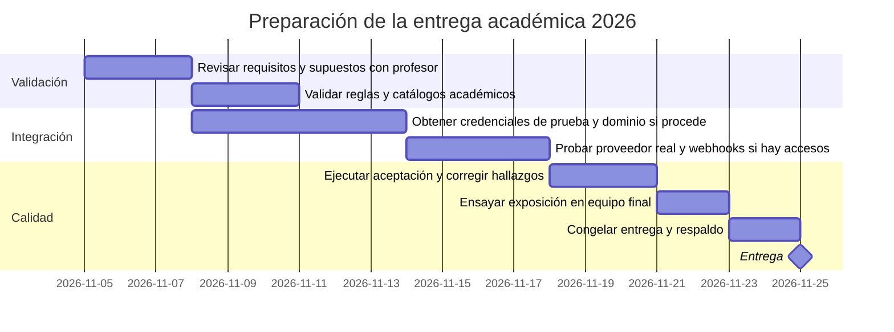

# Gestión del proyecto y GitFlow

## Alcance y objetivo

Entregar un prototipo académico demostrable de refrendo municipal: consulta, elegibilidad, liquidación, aportaciones, entrega, pago, PDF, QR, verificación, auditoría y documentación. Se incluye administración para mostrar el mantenimiento de catálogos y la trazabilidad.

Fechas del encargo proporcionadas por el alumno: publicación 28 de octubre y entrega 25 de noviembre de 2026. El cronograma siguiente es una **propuesta para preparación y validación desde el 5 de noviembre**, no un historial de actividades realizadas en fechas pasadas.

## EDT

| Paquete | Productos | Criterio de aceptación |
|---|---|---|
| 1. Análisis | SRS, supuestos, RTM y riesgos | Cada requisito tiene implementación y condición de validación |
| 2. Arquitectura y datos | Modelo, DER, catálogos, migraciones y seed | Base nueva se crea y contiene casos ficticios reproducibles |
| 3. Trámite ciudadano | Consulta, filtro, liquidación y entrega | Total verificable; giros restringidos no pueden pagar |
| 4. Pago y emisión | Simulación, adaptador MP, webhooks, PDF y QR | Solo un pago aprobado produce documento válido |
| 5. Operación | Gestión, guía, CSV y bitácora | Acceso con permisos y eventos verificables |
| 6. Calidad | Pruebas, revisión móvil, PDF y controles básicos de accesibilidad | Suite sin errores y evidencias de aceptación |
| 7. Entrega | Repositorio, instructivo, ZIP y guion | Se instala en equipo final y se demuestra de principio a fin |

## Cronograma propuesto de cierre



## Registro de riesgos

| Riesgo | Probabilidad / impacto | Respuesta |
|---|---|---|
| No obtener padrón municipal | Alta / alto | Padrón ficticio con siete casos y servicios aislados |
| No obtener credenciales o cuenta MP compatible | Media / alto | Modo demostración completo y declarar prueba externa pendiente |
| Tarifas o reglas legales incompletas | Alta / alto | Tabulador académico explícito y bloqueo de pagos externos hasta validación |
| Confundir PDF académico con autorización oficial | Media / alto | Etiqueta persistente en UI y carátula |
| No disponer de Internet en salón | Media / medio | Instalar previamente; recursos locales y pagos demo sin red |
| QR con localhost en teléfono | Alta / medio | Demostrar verificación en PC o desplegar HTTPS antes de clase |
| Cambio/pérdida de claves | Media / alto | Conservar claves con backups; no hay rotación histórica automática |
| Repetir pago pendiente | Media / alto | Reutilizar preferencia, esperar acreditación y conciliar |
| Saturación de SQLite | Baja en demo / alto en producción | PostgreSQL para concurrencia y pruebas de carga externas |
| Cambios de alcance tardíos | Media / alto | Congelar objetivos y registrar ajustes con RTM/pruebas |

## Control de cambios y aceptación

Cada cambio debe identificar requisito afectado, ajuste de datos/migración, prueba y riesgo. No se aceptan cambios manuales de estado a pagado desde el admin. Las correcciones contables se verifican contra el proveedor y quedan auditadas.

La aceptación académica incluye ejecutar el guion, revisar la RTM y explicar los pendientes externos. La aceptación municipal necesita validaciones jurídicas, fiscales, de seguridad, accesibilidad, integración y disponibilidad adicionales.

## Estrategia GitFlow

- `main`: versión entregable y etiquetada.
- `develop`: integración de desarrollo.
- `feature/portal-refrendo`: implementación, pruebas y documentación.
- `release/1.0.0`: congelación y notas de versión.
- Futuras correcciones urgentes: `hotfix/descripcion` desde main, reintegrada a main y develop.

Las ramas y commits fueron creados durante esta implementación; no se fabricó un historial anterior. Las ramas feature/release se conservan para revisión académica.

```text
git branch -a
git log --all --graph --decorate --oneline
git show v1.0.0
```

El ZIP incluye `repositorio.bundle`, que conserva el historial. Para restaurarlo en otra carpeta:

```text
git clone repositorio.bundle refrendo-tonala-con-historial
cd refrendo-tonala-con-historial
git switch -c develop origin/develop
```

Para publicar crea un repositorio vacío en tu cuenta:

```text
git remote add origin URL_DE_TU_REPOSITORIO
git push -u origin main
git push -u origin develop
git push origin --tags
```

No publicar .env, .local-settings.json, .demo-access.txt, bases de datos ni contraseñas. El ZIP fuente y bundle omiten esos archivos. El workflow CI se activará al subirlo a GitHub; no se ha ejecutado CI remoto en esta entrega.
